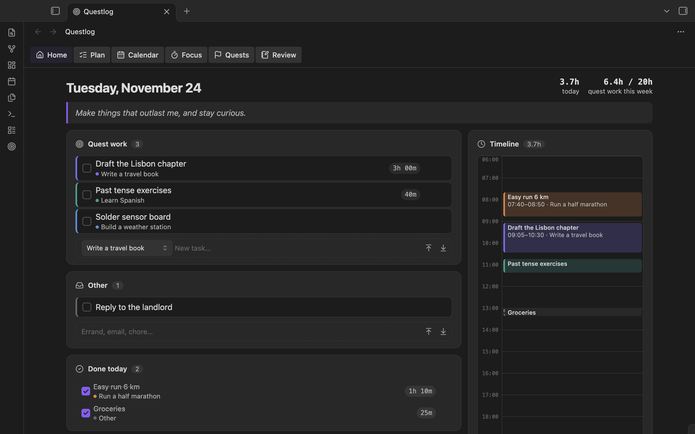
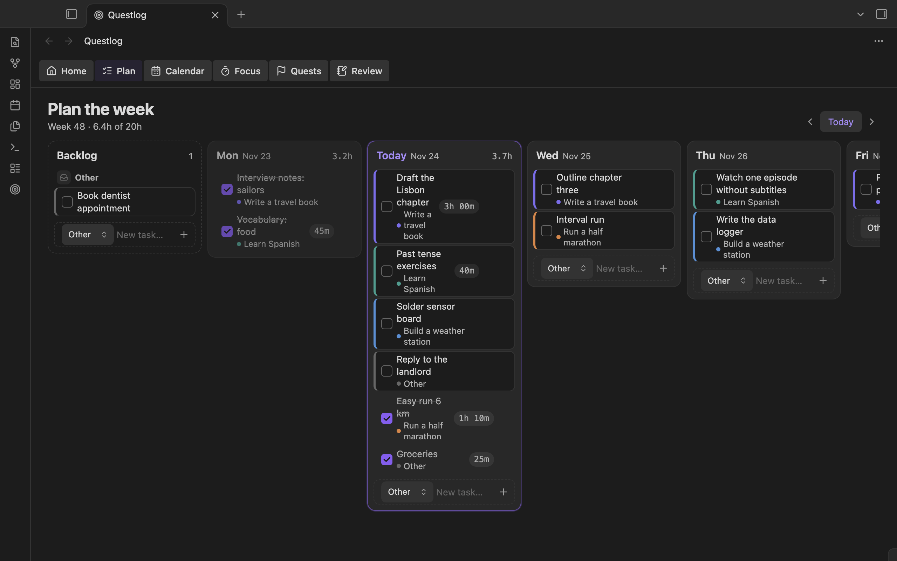
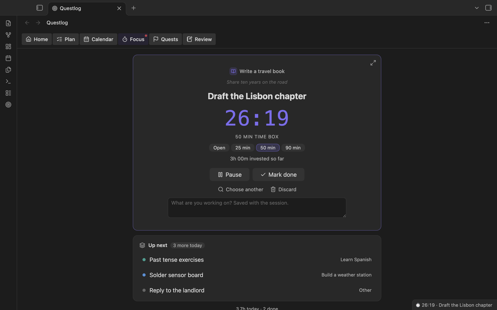

# Questlog

Focus on one task at a time, measure where your time actually goes, keep a done list, and reflect every week — with all data stored as plain Markdown in your vault.



Questlog is built around six principles:

1. **Only one task visible.** The Focus tab shows exactly one task: the one you are working on, or the next one in today's plan.
2. **Measure time.** A timer records how long you spend on each task. Every session lands in your calendar automatically.
3. **A done list, not a to-do list.** Home and Review show what you finished, not only what is left.
4. **Ritualised reflection.** A weekly review with charts and a few questions, saved as a note.
5. **Input over output.** A weekly hour target for quest work overall and per quest. Plan, Quests and Review compare the hours you invested against it.
6. **Vertical coherence.** Your personal vision sits on top of Home, and every quest has a *why*.

Questlog is standalone: it only writes into its own folder and never touches your daily notes or other plugins' files.

## Installation

In Obsidian, open **Settings → Community plugins → Browse**, search for **Questlog**, then install and enable it. Requires Obsidian 1.7.2 or later; works on desktop and mobile.

Manual installation: download `main.js`, `manifest.json` and `styles.css` from the [latest release](https://github.com/cmdhertel/obsidian-questlog/releases/latest) into `<vault>/.obsidian/plugins/questlog/` and enable the plugin.

## Getting started

1. Run **Questlog: Open** from the command palette, or click the target icon in the ribbon.
2. Create a quest in the **Quests** tab and give it a *why* and a weekly hour target.
3. Add a few tasks to today in **Home** or **Plan**.
4. Open **Focus** and press **Start**.

## Privacy

Questlog works offline. It makes no network requests, collects no data, and only writes to its own folder and its plugin settings.

## Tabs

| Tab | What it does |
| --- | --- |
| **Home** | Today: quest work and *Other* tasks (each with an add field), the done list, the backlog, and a timeline of today on wider panes. |
| **Plan** | A week board: backlog plus one column per day. Drag tasks between columns or use the task menu. Unfinished tasks of past days carry over to today by themselves. |
| **Calendar** | A week view filled from your timer sessions. Click an empty slot to add time, click a block to edit it. |
| **Focus** | One task, a large clock with an optional time box (25 / 50 / 90 min), a session note, and the next tasks of the day. |
| **Quests** | Quest cards with weekly progress; open one for its tasks, stats and settings. Create, pause, finish and reorder quests. |
| **Review** | The week in numbers: quest work vs. *Other*, hours per quest against target, a per-day chart, an 8-week trend, the done list, and the weekly questions. |





The layout adapts to the pane: a wide main tab, a narrow sidebar, or a phone. All controls are visible without hovering.

## Commands

- Open Questlog (and one command per tab)
- Start / stop timer
- Start a task… (fuzzy search)
- Complete current task
- Add task…

The status bar shows the running timer; click it to open Focus.

## Data format

Everything lives in one folder (default `Questlog/`, configurable):

```
Questlog/
  Quests/Write the book.md
  Other.md
  Days/2026-11-20.md
  Reviews/2026-W47.md
```

**Quest** — frontmatter plus a task list. The task syntax is compatible with the Tasks plugin.

```markdown
---
type: quest
status: active        # active | paused | done
why: Share what I learned in ten years of teaching
weekly_hours: 5
color: "#7c6cf0"
icon: book-open
---

## Tasks
- [ ] Outline chapters 🆔 k3j9x2
- [x] Research ✅ 2026-11-19 🆔 p0a8mf
```

**Other** — `Other.md` is the inbox for everything that is not quest work. Same task format, no frontmatter needed. Time spent on it counts as *Other*, not as quest work.

**Day** — the tasks planned for the day (by id) and the timer sessions, each with an optional note.

```markdown
---
type: questlog-day
date: 2026-11-20
plan: [k3j9x2]
---

## Sessions
- 09:15–10:05 Outline chapters · [[Write the book]] 🆔 k3j9x2 — first draft of part one
```

A task belongs to the latest day it was planned for. If that day is in the past and the task is still open, it shows up today; otherwise it sits in the backlog.

**Review** — the weekly answers, plus summary fields (`hours_total`, `hours_quests`, `hours_other`, `tasks_done`, `hours_<quest>`) in the frontmatter, so you can query them with Dataview.

You can edit any of these files by hand. Questlog picks up the changes immediately.

## Language

The interface is in English and German and follows Obsidian's language setting. Headings written in either language are recognised.

## Development

```bash
npm install
npm run dev            # watch build
npm run check          # type check, Obsidian lint rules, unit tests
npm run build          # type check + production bundle
VAULT=/path/to/vault npm run install:vault
npm run smoke          # macOS: runs the built plugin in a separate Obsidian (see below)
```

### Smoke test

`npm run smoke` builds the plugin, generates a demo vault (three quests, six weeks of sessions, no real content) and starts its **own** Obsidian with a separate profile and debugging port, in a new folder in the system's temp directory. It drives the app over the Chrome DevTools Protocol, runs the steps in `scripts/smoke/steps.mjs` (six tabs, timer, Start box, continue, play buttons, start earlier, modals) at three sizes in English and German, and writes `report.txt` and screenshots to `.smoke/out/<run>/` (git-ignored). The exit code is non-zero if a step fails. It does not touch your vault or your Obsidian profile, and it stops only the process it started. Your own Obsidian may keep running.

Options: `-- --keep` keeps the demo vault and profile, `-- --only <text>` runs matching steps, `-- --lang en|de`, `-- --no-build`, `-- --fail-test` adds a step that fails on purpose. Environment: `OBSIDIAN_BIN` (default `/Applications/Obsidian.app/Contents/MacOS/Obsidian`), `SMOKE_PORT`, `SMOKE_DIR` (parent of the work folder, must be inside the temp directory), `SMOKE_SCALE` (screenshot pixel ratio, default 1). The demo vault alone: `node scripts/smoke/demo-vault.mjs <empty-folder>`. To add a step, append an object to `steps` in `scripts/smoke/steps.mjs`; the comment at the top of that file explains the helpers. Phone size uses Obsidian's internal mobile emulation and is only a precheck. CI does not run the smoke test.

To release, run `npm version patch|minor|major`, then `git push --follow-tags`. GitHub Actions creates a draft release with `main.js`, `manifest.json` and `styles.css`; add notes and publish it.

## Credits

Inspired by Niklas Steenfatt's Quest app. Questlog is an independent project and not affiliated with it.

## License

MIT
